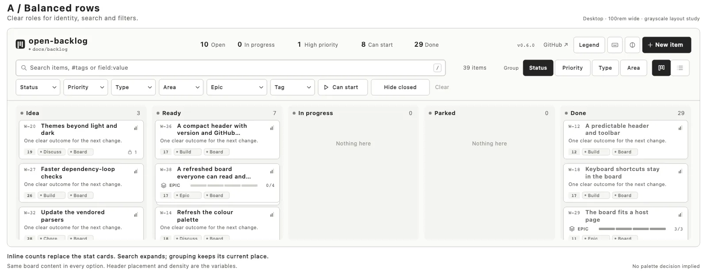
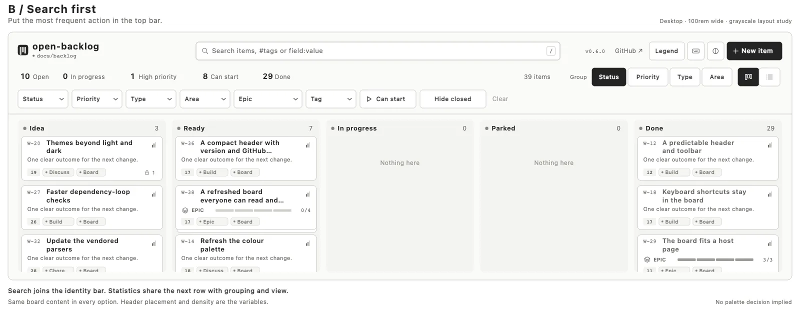
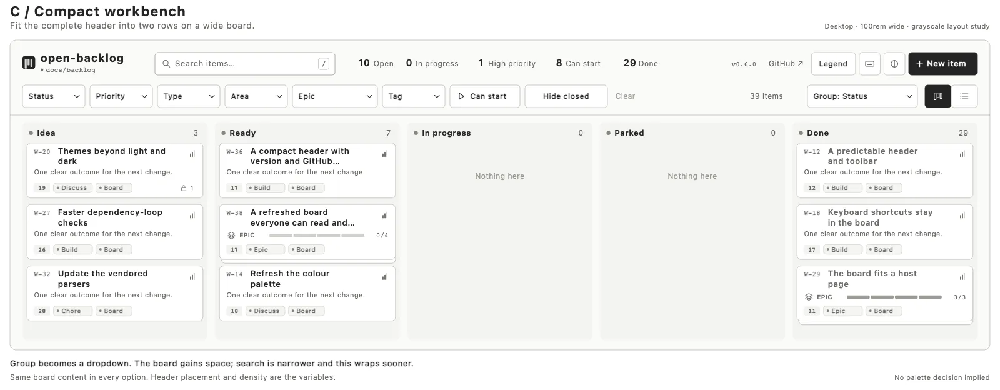
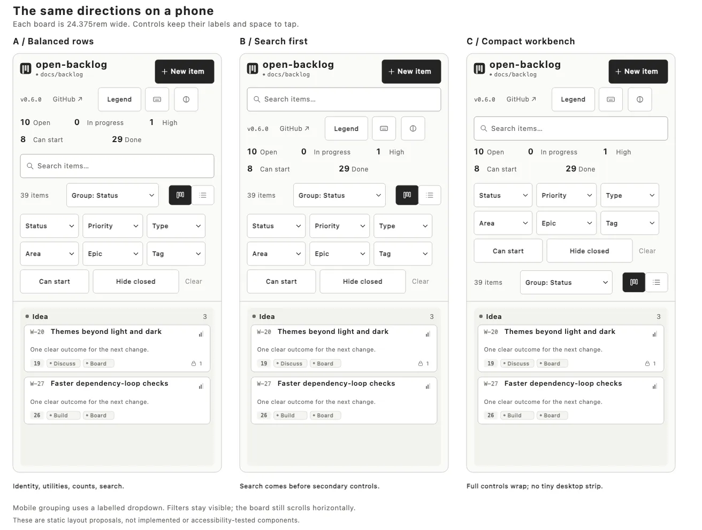

# Header wireframes

Three layout options for W-36, with the same frozen backlog data, controls and card treatment.
The drawings use grayscale so the comparison is about placement, hierarchy and density. They
do not select a palette or implement the application. No option is approved yet.

Use HEADER-A/B/C in feedback to distinguish these from DETAIL-A/B/C in the
[details gallery](item-detail-concepts.md). W-36's
[design references](backlog/compact-header-with-version-and-github-links.md#design-references)
link each image to its review questions.

[HEADER-COMPARE — Desktop comparison, WebP](backlog-assets/header-wireframes-comparison.webp) ·
[Editable comparison, SVG](backlog-assets/header-wireframes-comparison.svg) ·
[HEADER-PHONE — Phone comparison, WebP](backlog-assets/header-wireframes-mobile.webp) ·
[Phone comparison, SVG](backlog-assets/header-wireframes-mobile.svg)

The desktop frames represent `100rem` and the phone frames `24.375rem` at the same reference
scale. Production sizing remains in `rem`; these are static drawings, not responsive or
accessibility-tested components. Counts and version labels are a snapshot, not live data.

Raster previews are WebP copies optimised with `cwebp -q 80 -m 6` at their original dimensions.
The SVGs remain editable sources. Original PNG exports are preserved locally in the ignored
`docs/backlog-assets-local/` folder; the links here use the shared review copies.

| Option | Main change | Tradeoff |
| --- | --- | --- |
| HEADER-A — Balanced rows | Compact identity and inline counts; expanding search with grouping beside it; filters below. | Closest to W-36's current direction. Keeps the row roles clear, with a three-row header overall. |
| HEADER-B — Search first | Search joins the identity bar. Counts sit beside grouping and view controls on the next row. | Search is easier to reach and notice. Changes the current agreement that search, count, Group and view share a toolbar row. |
| HEADER-C — Compact workbench | Search, identity, counts and utilities share the first row. Filters, count, grouping and view share the second. | Most board space on wide screens. Search is narrower; Group becomes a dropdown, and extra fields or larger text need earlier wrapping. |

All three retain the smaller mark, configured project title, directory/connection indicator,
installed kit version, GitHub link, Legend, keyboard help, theme control, New item, search,
clickable counts, field/Epic/Tag filters, Can start, Hide closed and a reserved Clear position.
Clear is drawn faintly to show that reserved position. Filters remain visible in every option.

## A — Balanced rows

[Editable SVG](backlog-assets/header-wireframe-a-balanced-rows.svg)

The closest match to the existing toolbar contract. The large title and boxed counters become
a small identity and inline counts. Search takes the unused space on its row. On phones,
identity, utilities and counts precede the full-width search field.

## B — Search first

[Editable SVG](backlog-assets/header-wireframe-b-search-first.svg)

The recommended starting point if searching and opening items is the main daily activity.
Search sits in the top bar on desktop and immediately below the title on phones. Counts and
view settings form a quieter second row, with the filters below.

## C — Compact workbench

[Editable SVG](backlog-assets/header-wireframe-c-compact-workbench.svg)

The option for prioritising board space. It combines the header into two rows at the wide
reference size, using a labelled Group dropdown. On phones it expands into readable rows;
it does not shrink the desktop strip. Its advantage will be smaller in narrow host containers
or with additional configured fields.

## Phones and the next decision

The phone drawings use a labelled Group dropdown and visible filters. That is a proposed
change from the current grouping buttons and must be settled with the chosen layout.

Choose one direction, or combine specific parts, before the header build. Update W-36's row
roles and grouping behaviour to match that choice. No choice is recorded by adding these
wireframes, and no epic member has started implementation.
