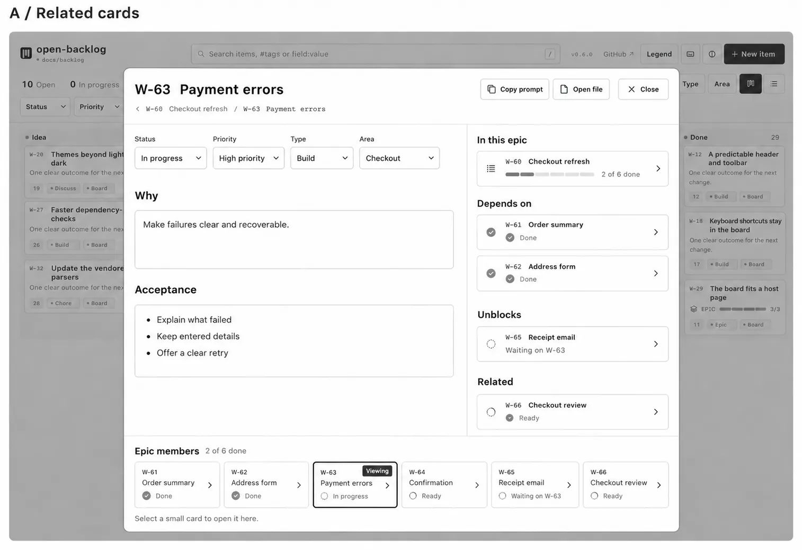
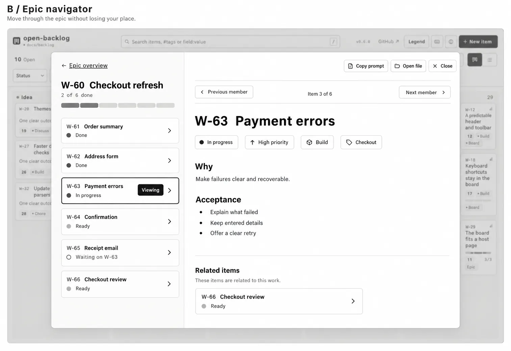
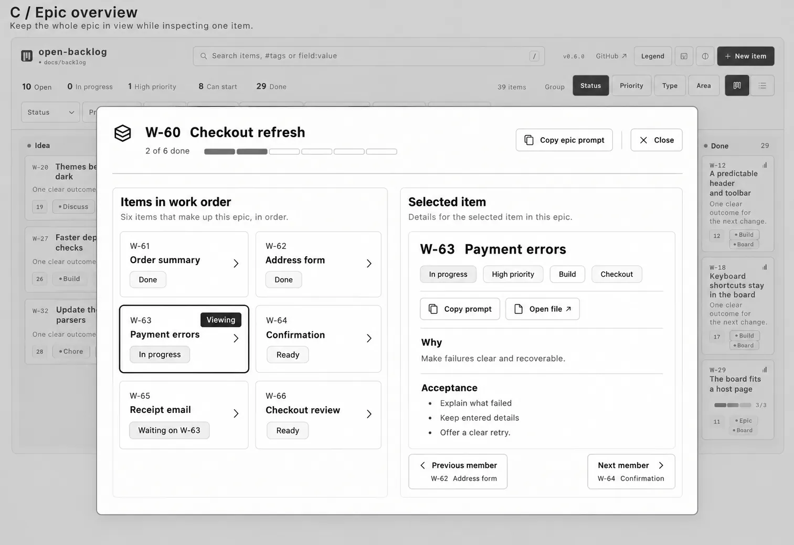
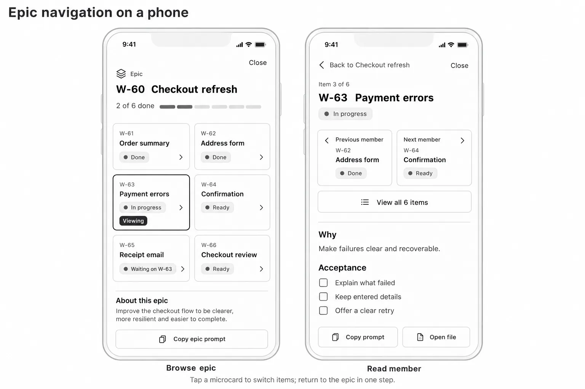
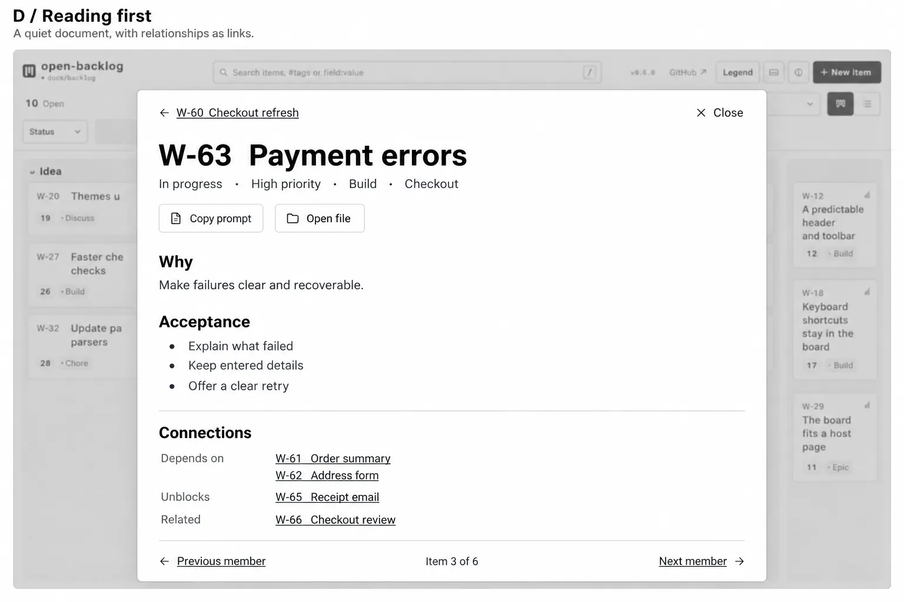
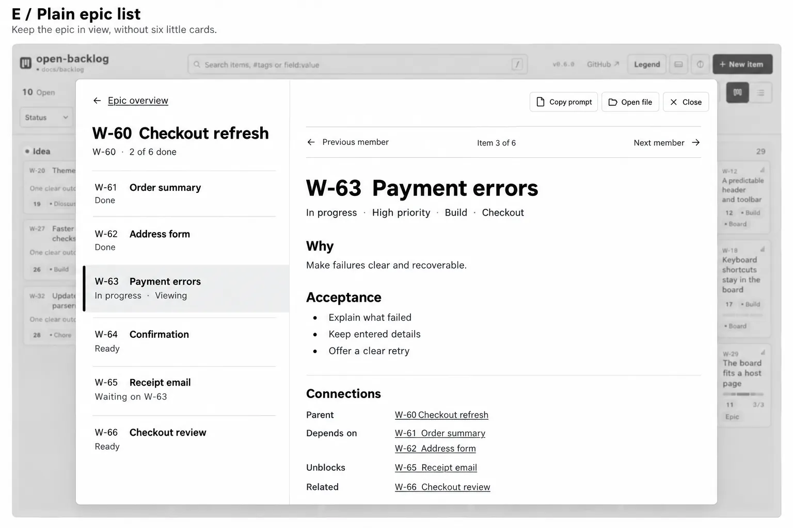
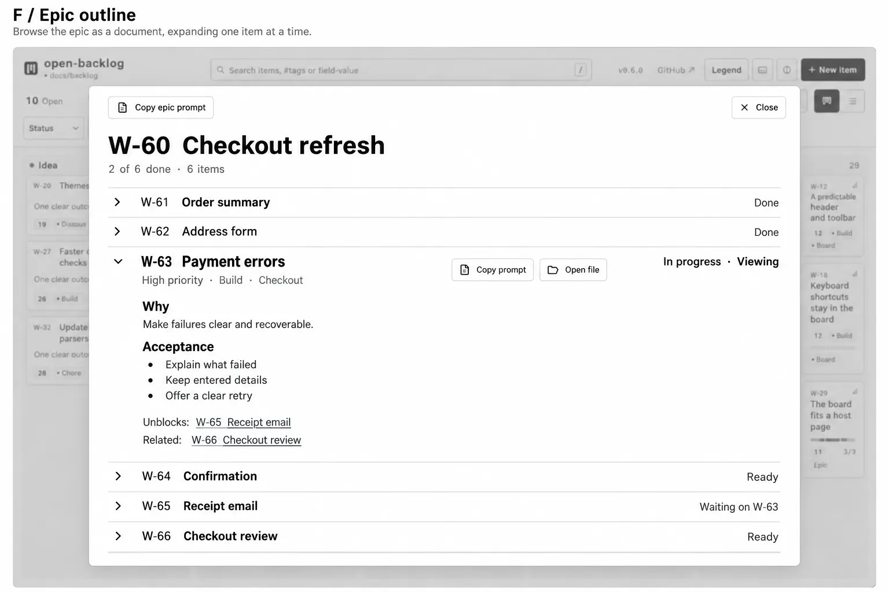
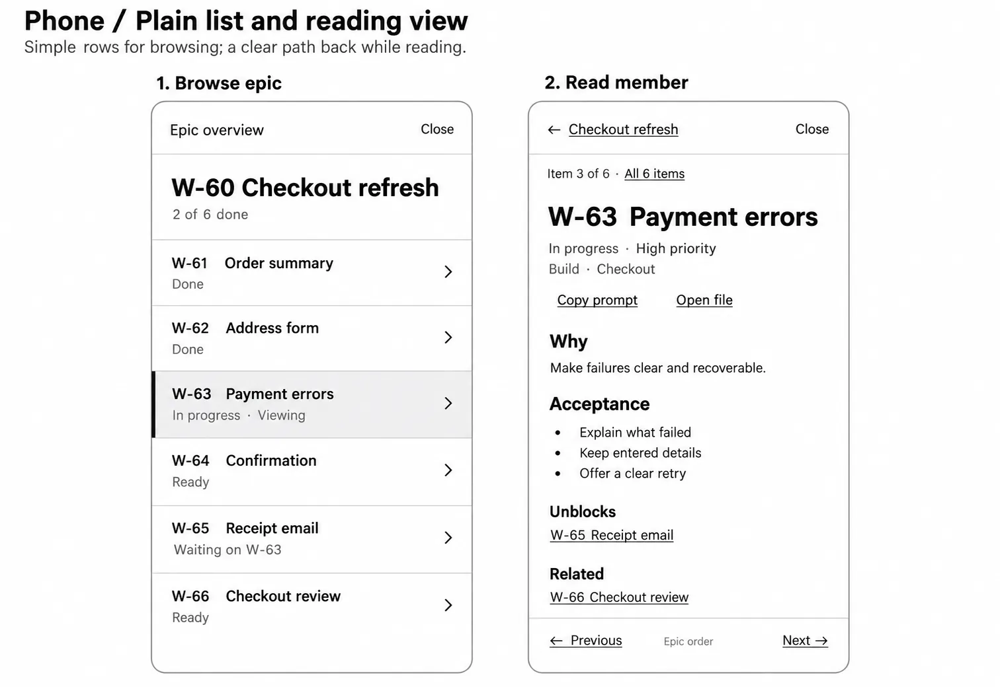

# Item detail layout concepts

Six desktop concepts and two phone treatments for W-35. A–C use microcards; D–F explore
ordinary links, a plain member list and an outline with one item expanded. All use the same
illustrative epic, W-60 Checkout refresh, with six members and two done. The examples are
fictional; these are design images, not live backlog screenshots, implementation or an
approved interaction.

Use DETAIL-A–F, DETAIL-PHONE-CARDS and DETAIL-PHONE-LIST in feedback. The labels distinguish
these from the HEADER-* set. W-35's
[design references](backlog/item-details-open-in-a-native-dialog.md#design-references) link
every image to a review perspective and the interaction decisions it leaves open.

| Concept | Best suited to | Main tradeoff |
| --- | --- | --- |
| DETAIL-A — Related cards | Reading an ordinary item and understanding its connections. | Grouped relations and the member strip take room, especially when the item has many connections. |
| DETAIL-B — Epic navigator | Quickly working through an epic while retaining its member list. | A persistent rail reduces the reading width and needs a different phone layout. |
| DETAIL-C — Epic overview | Surveying an epic and inspecting one member beside the others. | The grid makes each member easier to recognise, but consumes more space than a list. |
| DETAIL-D — Reading first | Reading an ordinary item with its connections as text links. | The full epic member list is one navigation step away. |
| DETAIL-E — Plain epic list | Moving directly between members while keeping the article readable. | The rail still uses reading width and needs a separate phone view. |
| DETAIL-F — Epic outline | Reading one member in the context of the whole epic document. | Expanding long items moves later headings down the page; history and focus need a clear policy. |
| DETAIL-PHONE-CARDS — Microcard navigation | Recognising members in a grid, then opening one to read. | Short titles and a clear return path matter; compare with full-width rows. |
| DETAIL-PHONE-LIST — Plain navigation | Scanning member rows, then reading with text navigation. | Less visual framing; links and rows still need generous touch targets. |

## A — Related cards

A reading column with compact relation cards in a sidebar: parent epic, Depends on, Unblocks
and Related. The strip underneath provides direct access to the epic's members. The groups
retain their names because identical-looking microcards must not imply identical relationships.

## B — Epic navigator

The microcard navigator keeps the epic's title, progress and member list
visible while the selected item's reading pane changes. An outline and the word Viewing
identify the current member. Previous member and Next member describe the navigation scope;
Epic overview gives a clear return path.

For a longer epic, the list would need its own usable scrolling and keep the selected member
visible. Items can belong to multiple epics, so the active epic context must be explicit rather
than silently choosing one.

## C — Epic overview

The parent epic is the main view. Its ordered member grid stays in place while a neighbouring
reading pane shows the selected child. This gives the whole epic more visual presence, at the
cost of reading space. It remains one workspace, with distinct Copy epic prompt and item-level
Copy prompt actions.

## Phone — Microcard navigation

The member list becomes a two-column microcard grid. Opening an item shows its details with
previous/next member cards, View all 6 items and a return link to the epic. The two phones show
different navigation states; they are not dialogs stacked over one another.

## D — Reading first

A centered reading column with a parent epic link, plain metadata and grouped relationship
links below the article. Previous member and Next member provide sequential movement without
keeping a member list on screen. This is the quietest option for an ordinary item; browsing
the whole epic needs a return to its overview.

## E — Plain epic list

The same persistent navigation as B, expressed as simple rows with titles and text states.
Separators, a full-width selection background, a left rule and Viewing identify the selected
member without enclosing every item in a card. The article's connections use ordinary links.
This preserves direct access to all six members with less visual framing.

## F — Epic outline

One flowing epic document, with six member headings and the selected item's article expanded
in place. The epic action and the selected item's actions remain distinct. This is useful for
reviewing an epic in order, but long articles push the following members further down the page.
Before building, settle how disclosure, the selected item's address, Back and focus work
together. The drawing does not require every member's full content to be rendered at once.

## Phone — Plain list and reading view

Full-width member rows replace the microcard grid. The reading view has a parent link,
All 6 items and previous/next text controls scoped to epic order. Relationships stay as named
text links. The two screens show successive views rather than stacked dialogs. Rows and links
still need comfortable touch targets; removing the boxes is not a reason to compress them.

## Interaction direction to explore

- Each microcard or member row shows a short ID, recognisable title and text state. Selection
  has a visible marker and label; colour is supplementary. Final symbols should follow W-40's audit
  and the agreed palette rather than treating the generated marks as new definitions.
- Make each navigational microcard or member row one link, with a complete accessible name
  and a visible keyboard focus state. Plain relationship links keep ordinary link semantics;
  F needs an explicit disclosure control if expanding and navigating are separate actions.
  Keep enough room for a useful title and comfortable touch targets. The later
  implementation follows the existing `rem` sizing requirement; these images are not measured
  layout specifications.
- Selecting a member switches the open item in the existing detail surface. Keep the epic's
  navigation context and reading position in its member list, and focus the new item heading
  as described by W-35. Show parent epics separately from ordinary relations.
- Keep the selected item addressable through `?item=<slug>`. W-35 must settle whether epic
  context also belongs in the address, and preserve its existing Back/close contract unless a
  different history policy is explicitly chosen.
- The illustrated Previous/Next controls follow epic work order. Existing j/k follows board
  order, so its scope needs an explicit decision before implementing epic navigation. Do not
  silently change that shortcut as part of drawing these layouts.
- Fields, progress marks and acceptance boxes are illustrative. These images do not approve
  new Markdown editing, interactive acceptance checkboxes, a palette or a modal policy.

Recommendation after comparing both sets: D is a strong default for ordinary items, and E
keeps the most useful part of B for epic navigation with less visual framing. F is a distinct
alternative for reviewing an epic as a document. These remain alternatives to choose between;
neither a layout nor a change to the navigation contract has been approved.

## Generation record

Created with the built-in `image_gen.imagegen` tool. The first set used the earlier header
wireframe as a style reference; the second used B to retain the same grayscale treatment and
fictional data. Both prompt sets are saved with the images:

- [Microcard prompts and revisions](backlog-assets/item-detail-concept-prompts.json)
- [Prompts for the alternatives without microcards](backlog-assets/item-detail-plain-concept-prompts.json)

No CLI image-generation fallback was used.

The review images were subsequently converted from PNG to WebP with `cwebp -q 80 -m 6`,
preserving their dimensions. Original PNGs are kept locally in the ignored
`docs/backlog-assets-local/` folder. The prompt records point to the review copies and record
the optimisation separately from generation; original `generated_source` paths are retained.
